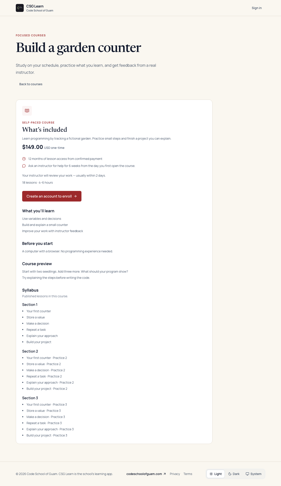
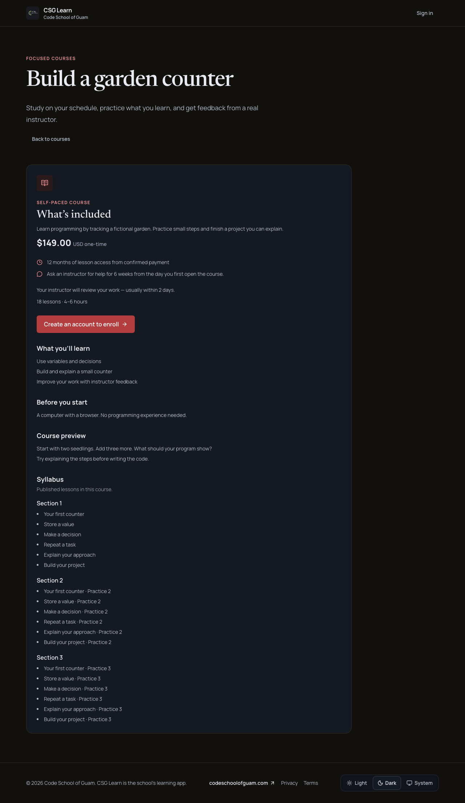

# Catalog and course pages — W6 PR 6.3

Agent-executed affected-flow QA. Base: main `51b0d7ce`, 2026-11-17.
Tested implementation: `8a765faafd020fa4822eebe2614d1e6ca5b0ba2f`. The follow-up QA-record commit changes
documentation only. Chromium local harness on macOS; Ruby 3.3.7 and PostgreSQL 16
on the ASUS runner for the full API suite.

## Context and acceptance

Learners need public course information before buying, a clear first step after
purchase, and the same instructor-review promise in every delivery mode. Admins
maintain public copy and response times without changing checkout visibility.
Sources: the W6 PR 6.3 brief, redesign README §§1–7 and 12, launch controls,
BRANDING.md, #275 setup wizard, CourseCheckout, enrollment and grading code,
and the Brain Dump platform audit's S-2/S-3/S-8/S-18 and W6 implementation plan.
Production's no-sales/no-purchases state is supplied context, not reverified here.

Design: inherit the public cream/Newsreader and ruby system with dark tokens.
Course marketing leads with outcomes and practical requirements; numbered
sections expose published lesson titles, without internal module names or bodies.
No new motion: content, checkout and dismissal settle immediately. Existing button
feedback respects the shared reduced-motion rules. Invitation access remains
visible alongside course browsing. Native has no public catalog or checkout screen;
no new native purchase surface is introduced.

## Required scenario ledger

All scenarios use isolated synthetic QA fixtures, Chromium, 1280 and 390 CSS-pixel
viewports, light and dark. These dimensions do not establish real-device or Safari
coverage. Checkout is simulated unless local sandbox keys can be verified.

| ID | Starting state and UI actions | Expected saved/visible outcome | Status |
| --- | --- | --- | --- |
| C1 | Signed out: open landing, browse available course | Only on-sale courses shown; invitation and sign-in reachable | passed |
| C2 | Open catalog, course detail, syllabus and back link | Public title/copy, duration, prerequisites, preview and lesson count; no private content | passed |
| C3 | Open old offering ID link and an unlisted slug | Old selection retained; unavailable course has no checkout action | passed |
| C4 | Signed-in eligible learner: start checkout | Reach hosted sandbox or clearly labelled stub; terms/session behavior unchanged | passed |
| C5 | Paid return: open course, dismiss Start here, reload | Today for purchased cohort; help window and response time; dismissal persists | passed |
| C6 | Self-paced and guided: inspect submitted waiting work | Instructor review promise and configured response time; staff queue includes delivery badge | passed |
| C7 | Admin edits public marketing and school/cohort review time | Values persist; inherited default works; checkout visibility unchanged | passed |

## Verification and evidence

Browser: all seven required cases passed at all four viewport/theme combinations.
The main matrix passed 19/20, then C6 passed all four dimensions after waiting for
Related loading to settle. A stronger C7 edit/save/reload rehearsal passed all four
dimensions after selecting the inline success message. C6/C7 were then rerun with an
explicitly guided cohort and a learner-visible three-day override: all eight runs passed. These retests cover the same
implementation; the first run was not clean.

C1–C3: signed-out browser navigation covered landing → catalog → course, public
syllabus/preview/prerequisites, selected legacy offering links, and unavailable
slugs, including a known private guided offering. C4: buyer persona 9 reached a
labelled hosted-page simulation after exactly
one request for cohort 2. No local sandbox key was found in process configuration
or the current/canonical API env files. No real Stripe session or payment ran.
C5: persona 7 opened the synthetic paid return, followed Open course to
`/dashboard?cohort_id=2`, read the six-week support window, dismissed Start here,
reloaded and verified it stayed dismissed; opening `/` skipped the landing page.
C6: self-paced persona 6 and persona 3 in an explicitly guided cohort saw
waiting-review copy and the default response time; instructor persona 2 saw
Self-paced in the same queue.
C7: admin changed duration to 5–7 hours, saved, reloaded and verified it, restored
4–6 hours, saved a three-day cohort response override, reloaded, verified the
three-day time in the learner’s lesson, then cleared it
to inherit the school default. Checkout remained checked throughout.

Stable-page axe WCAG 2.1 AA scans found no serious/critical violations, including
contrast, in the tested paths. No horizontal overflow. Public links and back navigation were exercised; keyboard-only traversal was
not run; no new animation was added. Impeccable advisory
scan returned `[]`. Native, Safari/WebKit, real phones, Clerk signup, provider
transport, real video playback and production deployment were not tested.

Web final gate on ASUS: typecheck, ESLint, Vitest (200 files / 2,342 tests),
production build, `test:bundle`, and `api:check` all passed. Mobile on Node 22.22.3:
typecheck, ESLint (zero errors; 50 existing warnings), and Jest (136 suites /
1,418 tests) all passed. Both generated API type files match OpenAPI.

API final gate on ASUS: `OPENAPI_COVERAGE=1 PARALLEL_WORKERS=1` full suite
passed: 1,848 tests / 40,285 assertions, zero failures/errors/skips. OpenAPI
response/schema/error coverage passed. RuboCop inspected 677 files with no
offenses. Brakeman: zero errors and zero security warnings (one existing ignored
warning). The final full run used the runner-only port adapter and
`prepared_statements=false`; no repository tests were skipped or filtered.

## Runtime notes

The first full API run had 1,848 runs, zero assertion failures and three runner
errors: existing `MigrationDatabaseProcessTest` cases connect directly to port
5432, while `asus-test` publishes its disposable PostgreSQL on 55432. A runner-only
port adapter is used for the final full pass; repository test source is unchanged.
The second API run reached 1,848 runs with zero assertion failures and one
pre-existing concurrency error (`cached plan must not change result type`) after
schema-rewriting migration fixtures. The final run disables prepared statements
on the disposable test connection, as the project's transaction-pooler gate does.
The ASUS build also needs a temporary Git index for `git ls-files -- brand-public`,
because `asus-test` intentionally omits `.git` from its secret-free source copy.

Initial browser failures were test-fixture/locator issues: the waiting submissions
are lessons 23 and 5, not 21 and 3; the settings success appears both inline and in a
toast, so assertions now select the inline message. A transient pre-existing Related
loading placeholder uses a prohibited `aria-label` on a generic div; settled-page
accessibility checks now wait for loading to finish. No changed screen had a
settled-state serious/critical axe finding or horizontal overflow in completed runs.

## Screenshots

Synthetic fixtures only. Full-page desktop evidence:

| Screen | Light | Dark |
| --- | --- | --- |
| Landing |  |  |
| Course |  |  |

Phone: [landing light](catalog-course-pages-2026-11-17/landing-390-light.png),
[landing dark](catalog-course-pages-2026-11-17/landing-390-dark.png),
[course light](catalog-course-pages-2026-11-17/course-390-light.png),
[course dark](catalog-course-pages-2026-11-17/course-390-dark.png).
Start here: [desktop light](catalog-course-pages-2026-11-17/start-here-1280-light.png),
[desktop dark](catalog-course-pages-2026-11-17/start-here-1280-dark.png),
[phone light](catalog-course-pages-2026-11-17/start-here-390-light.png),
[phone dark](catalog-course-pages-2026-11-17/start-here-390-dark.png).

## Deployment and cleanup

Migration `20261117090000` is later than every migration on the requested main.
It adds marketing/response/orientation fields and the unique slug index, backfills
opaque ID-based slugs without touching checkout, and preserves purchase snapshots.
Deploy the API migration before clients depend on the new public fields. No sales
flags, provider configuration, prices or production data were changed by this task.
PR is to remain unmerged; deployed availability is not claimed.

Runtime cleanup: the exact Rails and Vite PIDs, Playwright workers, and owned
preview tab were stopped/closed and released. The harness database
`csg_qa_22201_1794866616`, guided-retest database
`csg_qa_73590_1794867590`, and schema rehearsal database
`csg_qa_catalog_schema_01a1e659` were dropped; PostgreSQL catalog checks found
none of these databases. `dev-lifecycle status` reports no active owned resources.
The ASUS wrapper removes its disposable PostgreSQL container and databases at
exit. No shared service, simulator, unrelated tab or worktree was stopped.
