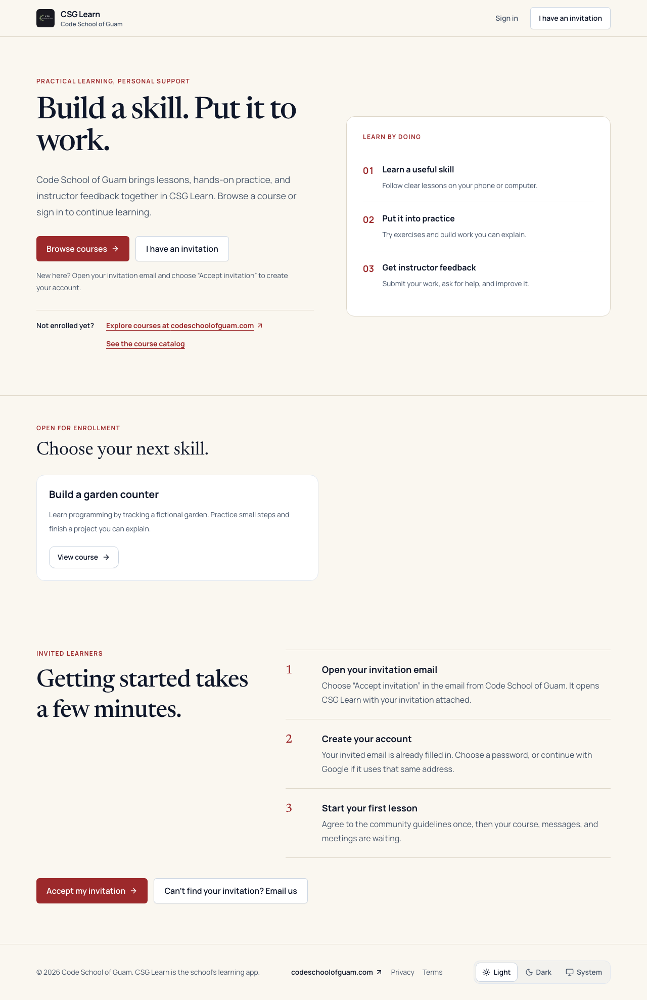
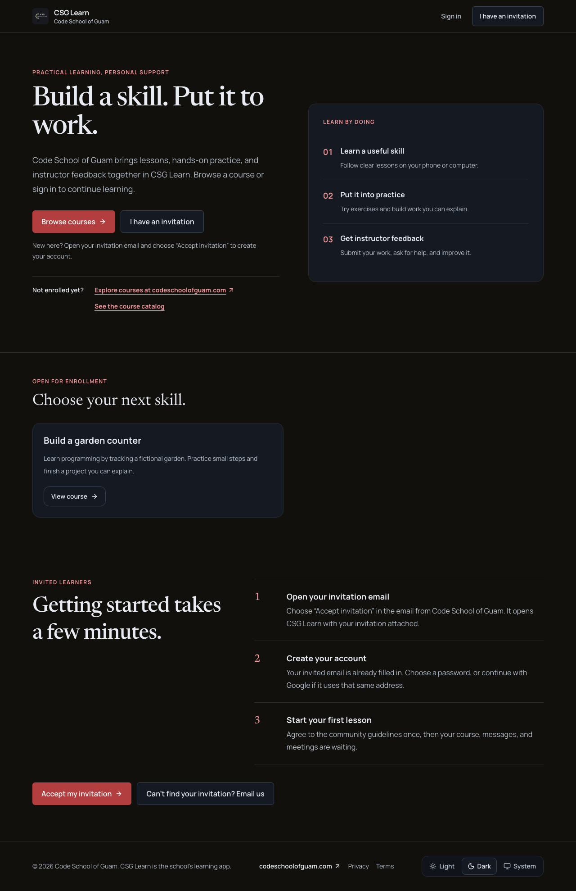

# Catalog and course pages — W6 PR 6.3

Agent-executed affected-flow QA. Base: main `51b0d7ce`, 2026-11-17.
Latest integrated application/test source: `5c96144a` (main `aa0cf1b4` plus the
six review fixes). Both full API modes and all client gates passed; see the final
sections for current results and retained failed-run observations.
Initial implementation: `8a765faafd020fa4822eebe2614d1e6ca5b0ba2f`. Fix-round results
below supersede the initial gate and screenshots where indicated. Chromium local harness on macOS; Ruby 3.3.7 and PostgreSQL 16
on the ASUS runner for the full API suite.

## Context and acceptance

Learners need public course information before buying, a clear first step after
purchase, and the same instructor-review promise in every delivery mode. Admins
maintain public copy and response times without changing checkout visibility.
Sources: the W6 PR 6.3 brief, redesign README §§1–7 and 12, launch controls,
BRANDING.md, #275 setup wizard, CourseCheckout, enrollment and grading code,
and the Brain Dump platform audit's S-2/S-3/S-8/S-18 and W6 implementation plan.
Production's no-sales/no-purchases state is supplied context, not reverified here.

Design: inherit the public cream/Newsreader and ruby system with dark tokens.
Course marketing leads with outcomes and practical requirements; numbered
sections expose published lesson titles, without internal module names or bodies.
No new motion: content, checkout and dismissal settle immediately. Existing button
feedback respects the shared reduced-motion rules. Invitation access remains
visible alongside course browsing. Native has no public catalog or checkout screen;
no new native purchase surface is introduced.

## Required scenario ledger

All scenarios use isolated synthetic QA fixtures, Chromium, 1280 and 390 CSS-pixel
viewports, light and dark. These dimensions do not establish real-device or Safari
coverage. Checkout is simulated unless local sandbox keys can be verified.

| ID | Starting state and UI actions | Expected saved/visible outcome | Status |
| --- | --- | --- | --- |
| C1 | Signed out: open landing, browse available course | Only on-sale courses shown; invitation and sign-in reachable | passed |
| C2 | Open catalog, course detail, syllabus and back link | Public title/copy, duration, prerequisites, preview and lesson count; no private content | passed |
| C3 | Open old offering ID link and an unlisted slug | Old selection retained; unavailable course has no checkout action | passed |
| C4 | Signed-in eligible learner: start checkout | Reach hosted sandbox or clearly labelled stub; terms/session behavior unchanged | passed |
| C5 | Paid return: open course, dismiss Start here, reload | Today for purchased cohort; help window and response time; dismissal persists | passed |
| C6 | Self-paced and guided: inspect submitted waiting work | Instructor review promise and configured response time; staff queue includes delivery badge | passed |
| C7 | Admin edits public marketing and school/cohort review time | Values persist; inherited default works; checkout visibility unchanged | passed |

## Initial verification and evidence

These pre-review results are historical; the Fix round 1 section records the
merged implementation and current acceptance.

Browser: all seven required cases passed at all four viewport/theme combinations.
The main matrix passed 19/20, then C6 passed all four dimensions after waiting for
Related loading to settle. A stronger C7 edit/save/reload rehearsal passed all four
dimensions after selecting the inline success message. C6/C7 were then rerun with an
explicitly guided cohort and a learner-visible three-day override: all eight runs passed. These retests cover the same
implementation; the first run was not clean.

C1–C3: signed-out browser navigation covered landing → catalog → course, public
syllabus/preview/prerequisites, selected legacy offering links, and unavailable
slugs, including a known private guided offering. C4: buyer persona 9 reached a
labelled hosted-page simulation after exactly
one request for cohort 2. No local sandbox key was found in process configuration
or the current/canonical API env files. No real Stripe session or payment ran.
C5: persona 7 opened the synthetic paid return, followed Open course to
`/dashboard?cohort_id=2`, read the six-week support window, dismissed Start here,
reloaded and verified it stayed dismissed; opening `/` skipped the landing page.
C6: self-paced persona 6 and persona 3 in an explicitly guided cohort saw
waiting-review copy and the default response time; instructor persona 2 saw
Self-paced in the same queue.
C7: admin changed duration to 5–7 hours, saved, reloaded and verified it, restored
4–6 hours, saved a three-day cohort response override, reloaded, verified the
three-day time in the learner’s lesson, then cleared it
to inherit the school default. Checkout remained checked throughout.

Stable-page axe WCAG 2.1 AA scans found no serious/critical violations, including
contrast, in the tested paths. No horizontal overflow. Public links and back navigation were exercised; keyboard-only traversal was
not run; no new animation was added. Impeccable advisory
scan returned `[]`. Native, Safari/WebKit, real phones, Clerk signup, provider
transport, real video playback and production deployment were not tested.

Web final gate on ASUS: typecheck, ESLint, Vitest (200 files / 2,342 tests),
production build, `test:bundle`, and `api:check` all passed. Mobile on Node 22.22.3:
typecheck, ESLint (zero errors; 50 existing warnings), and Jest (136 suites /
1,418 tests) all passed. Both generated API type files match OpenAPI.

API final gate on ASUS: `OPENAPI_COVERAGE=1 PARALLEL_WORKERS=1` full suite
passed: 1,848 tests / 40,285 assertions, zero failures/errors/skips. OpenAPI
response/schema/error coverage passed. RuboCop inspected 677 files with no
offenses. Brakeman: zero errors and zero security warnings (one existing ignored
warning). The final full run used the runner-only port adapter and
`prepared_statements=false`; no repository tests were skipped or filtered.

## Initial runtime notes

The first full API run had 1,848 runs, zero assertion failures and three runner
errors: existing `MigrationDatabaseProcessTest` cases connect directly to port
5432, while `asus-test` publishes its disposable PostgreSQL on 55432. A runner-only
port adapter is used for the final full pass; repository test source is unchanged.
The second API run reached 1,848 runs with zero assertion failures and one
cached-plan error (`cached plan must not change result type`) after schema-rewriting
migration fixtures. The initial assessment that this was unrelated was wrong:
adding the orientation column exposed a migration fixture that reordered enrollment
columns without clearing every pooled connection. Disabling prepared statements
made that initial run pass but did not prove the fix. Fix round 1 repairs cache
invalidation and runs both connection modes, including default seed 26023.
The ASUS build also needs a temporary Git index for `git ls-files -- brand-public`,
because `asus-test` intentionally omits `.git` from its secret-free source copy.

Initial browser failures were test-fixture/locator issues: the waiting submissions
are lessons 23 and 5, not 21 and 3; the settings success appears both inline and in a
toast, so assertions now select the inline message. A transient pre-existing Related
loading placeholder uses a prohibited `aria-label` on a generic div; settled-page
accessibility checks now wait for loading to finish. No changed screen had a
settled-state serious/critical axe finding or horizontal overflow in completed runs.

## Screenshots

Synthetic fixtures only. Full-page desktop evidence:

| Screen | Light | Dark |
| --- | --- | --- |
| Landing |  |  |
| Course |  |  |

Phone: [landing light](catalog-course-pages-2026-11-17/landing-390-light.png),
[landing dark](catalog-course-pages-2026-11-17/landing-390-dark.png),
[course light](catalog-course-pages-2026-11-17/course-390-light.png),
[course dark](catalog-course-pages-2026-11-17/course-390-dark.png).
Start here: [desktop light](catalog-course-pages-2026-11-17/start-here-1280-light.png),
[desktop dark](catalog-course-pages-2026-11-17/start-here-1280-dark.png),
[phone light](catalog-course-pages-2026-11-17/start-here-390-light.png),
[phone dark](catalog-course-pages-2026-11-17/start-here-390-dark.png).

## Deployment and cleanup

Migration `20261117090000` is later than every migration on the requested main.
It adds marketing/response/orientation fields and the unique slug index, backfills
readable public-title slugs (with collision suffixes and safe ID fallbacks) without touching checkout, and preserves purchase snapshots.
Deploy the API migration before clients depend on the new public fields. No sales
flags, provider configuration, prices or production data were changed by this task.
PR is to remain unmerged; deployed availability is not claimed.

Runtime cleanup: the exact Rails and Vite PIDs, Playwright workers, and owned
preview tab were stopped/closed and released. The harness database
`csg_qa_22201_1794866616`, guided-retest database
`csg_qa_73590_1794867590`, and schema rehearsal database
`csg_qa_catalog_schema_01a1e659` were dropped; PostgreSQL catalog checks found
none of these databases. `dev-lifecycle status` reports no active owned resources.
The ASUS wrapper removes its disposable PostgreSQL container and databases at
exit. No shared service, simulator, unrelated tab or worktree was stopped.

## Fix round 1 — acceptance and execution

Tested application code: `e7b22fa1` (fixes in `12aec257`, merged main through
`c62eb42a`, including #281 grading workbench and #279 Updates composer). The
follow-up commit adds the browser regression, refreshed screenshots and this
record. The server-paged queue's existing delivery label replaces the old badge.
OpenAPI was merged and both clients regenerated after each main merge.

The migration fixture now clears every pooled connection after restoring
`enrollments.content_moved_at`. Other structural down/up fixtures received the
same cleanup. The gate asserts the actual connection mode before each full run;
the default run must retain prepared statements. The runner-only port adapter
remains necessary for `MigrationDatabaseProcessTest` and changes no checked-in
source.

| Fix-round acceptance | Evidence | Result |
| --- | --- | --- |
| Automatic / Always / Hidden, with and without a sale | Home unit matrix and six actual API-backed browser states per dimension | passed |
| Course page, old offering link and unavailable course | Public navigation, page title, no retry on 404, Hidden recovery to Sign in | passed |
| One-time Start here, including an A-to-B dismissal race | Paid return/dismiss/reload browser flow and deferred-response component test | passed |
| Readable immutable addresses | API regressions for transliteration, collision suffixes, blank/reserved fallback and migration parity | passed in both full modes |
| Flat missing-slug lookup | QueryCounter before/after 20 added candidates | passed in both full modes |
| Readiness uses unsaved public copy | Offering form regression | passed |
| Response-time draft participates in Save settings and navigation guard | Cohort form regressions plus edit/save/reload and learner-visible override in browser | passed |
| Natural review copy and self-paced queue context | Phrase regressions, guided/self-paced browser lessons and merged grading queue | passed |

Browser rerun: **24/24 Playwright tests passed** on local Chromium, 1280 and
390 CSS pixels, light and dark. Every dimension covered all six landing-policy
conditions, public navigation, course/unlisted pages, simulated checkout, paid
Today/Start here, both review modes, grading context, and saved admin marketing
and response-time edits. Stable-state axe scans found no serious/critical WCAG
2.1 AA violations and no horizontal overflow. These checks do not establish
Safari, native-device, real Clerk signup, real Stripe transport or deployment
coverage. The hosted checkout remains explicitly stubbed because no local sandbox
keys were available. No payment or provider session was created.

Focused web regressions after merging #279: 7 files / 53 tests passed. Focused API:
10 runs / 78 assertions passed. Both full API runs on ASUS used seed 26023 and
`OPENAPI_COVERAGE=1 PARALLEL_WORKERS=1`: **1,899 tests / 40,910 assertions each,
zero failures/errors/skips**, first with prepared statements enabled, then with
`?prepared_statements=false`. RuboCop: 684 files, no offenses. Brakeman: zero
errors and zero security warnings (one existing ignored warning). The first full web run stopped at one obsolete Dashboard sentence assertion
(2,406 other tests passed). `04fd20eb` updates that assertion and checks both
default and configured response phrases; its focused Dashboard suite passed
25/25 tests. No application code changed after the browser run. The complete web rerun passed on ASUS: typecheck, ESLint, Vitest
(208 files / 2,408 tests), build, `test:bundle` and `api:check`. Both generated
clients match OpenAPI. Mobile on Node 22.22.3: typecheck and lint passed (74 warnings, zero errors);
Jest passed 136 suites / 1,428 tests. The ASUS command exited successfully. Impeccable advisory scan: `[]`.

Updated course and Start-here screenshots above come from this round. Landing
policy evidence (each also has 390px and dark variants alongside it):

| Policy and sale state | Light | Dark |
| --- | --- | --- |
| Automatic, empty | [desktop](catalog-course-pages-2026-11-17/landing-automatic-empty-1280-light.png) | [desktop](catalog-course-pages-2026-11-17/landing-automatic-empty-1280-dark.png) |
| Automatic, on sale | [desktop](catalog-course-pages-2026-11-17/landing-automatic-sale-1280-light.png) | [desktop](catalog-course-pages-2026-11-17/landing-automatic-sale-1280-dark.png) |
| Always, empty | [desktop](catalog-course-pages-2026-11-17/landing-always-empty-1280-light.png) | [desktop](catalog-course-pages-2026-11-17/landing-always-empty-1280-dark.png) |
| Always, on sale | [desktop](catalog-course-pages-2026-11-17/landing-always-sale-1280-light.png) | [desktop](catalog-course-pages-2026-11-17/landing-always-sale-1280-dark.png) |
| Hidden, empty | [desktop](catalog-course-pages-2026-11-17/landing-hidden-empty-1280-light.png) | [desktop](catalog-course-pages-2026-11-17/landing-hidden-empty-1280-dark.png) |
| Hidden, on sale | [desktop](catalog-course-pages-2026-11-17/landing-hidden-sale-1280-light.png) | [desktop](catalog-course-pages-2026-11-17/landing-hidden-sale-1280-dark.png) |
| Unavailable, catalog hidden | [desktop](catalog-course-pages-2026-11-17/unlisted-hidden-1280-light.png) | [desktop](catalog-course-pages-2026-11-17/unlisted-hidden-1280-dark.png) |

Fix-round cleanup: both harness databases (`csg_qa_87149_1794873335` and
`csg_qa_19116_1794873657`) and targeted API database
`csg_qa_catalog_r1_targeted_test` were dropped. Exact task-owned Rails/Vite PIDs,
Playwright processes and the preview tab were stopped/closed; lifecycle status
reports no active owned browser/server resources. ASUS verification completed successfully; its wrapper removed the disposable
PostgreSQL container and test databases and terminated its WSL instance at exit.
The exact client-gate process has exited. No runtime resource is handed off.

Follow-ups outside this round: show review time on My work when it arrives in W8;
mobile Start-here card and review time.

## Deferred slug follow-up

Review base: `5aee7056`. Implementation: `21c74d67`; merged tree under test:
`56dff1bb`, including main `bcd0d461` (#282 help-request replies). Refreshed
acceptance comes from Leon's wizard review: creation without public copy must
leave the address unassigned; the first saved public title assigns it; later
edits keep it stable. Public catalog payloads must keep their non-null slug
contract while untitled drafts and rows awaiting backfill stay unlisted.

`before_save` now assigns only when the slug is NULL and a public title is
present. Advisory locking, collision suffixes, transliteration, reserved-name
fallback and immutability remain. The migration skips NULL/whitespace titles.
The offerings relation filters NULL slugs, and the serializer rejects them.
Exact public payload keys and offering-ID compatibility remain unchanged.
OpenAPI was merged with #282 and both clients regenerated rather than hand-merged.
Migration `20261117090000` remains later than #282's latest `20261117050000`.

ASUS red/green proof on the merged source: all six targeted regressions failed
against the previous behavior (six failures, no errors), then the fixed focused
suite passed **78 tests / 443 assertions, zero failures/errors/skips**. Cases cover
API wizard create → save title → rename; two late identical titles; late reserved
title fallback; blank-title backfill followed by title assignment; exclusion from
listing/slug lookup; and serializer rejection of an unassigned address. The
backfill test retains a pool-wide `clear_cache!` in `ensure`.

The first focused pass caught a checkout fixture that should remain untitled for
its fallback-title assertion; the title is now set only in its catalog scenario.
The pre-#282 default-mode run was deliberately interrupted at 270 tests when main
moved; it is not a completed gate. Both full modes and client gates are being
rerun against the merged tree, with seed 26023 and the runner-only port adapter.
Prepared statements remain enabled in the default run.

Full merged API results: both prepared-statement modes passed seed 26023 with
`OPENAPI_COVERAGE=1 PARALLEL_WORKERS=1`: **1,930 tests / 41,119 assertions each**,
zero failures/errors/skips. The default run asserted prepared statements enabled;
the second asserted them disabled via `?prepared_statements=false`. RuboCop
inspected 696 files with no offenses. Brakeman: zero security warnings and errors
(one existing ignored warning). Web typecheck, ESLint, Vitest (210 files /
2,423 tests), production build, `test:bundle` and `api:check` passed. Mobile
typecheck and lint passed (74 warnings, zero errors). All 1,430 Jest tests
passed initially, but the command stayed alive on a default five-minute mutation
cache timer after the newly merged help-reply test unmounted. The exact owned
Jest PID was interrupted. `d6179ed6` gives that test fixture zero-lifetime mutation
caches, matching its query cache and the existing teaching-ops test pattern. The
focused `--detectOpenHandles` run passed 33 tests and exited normally; the full
mobile rerun passed **136 suites / 1,430 tests** and exited with status 0, without
an open-handle warning or forced-exit flag. Typecheck and lint passed again
(74 warnings, zero errors). No application code changed after the API/web gates. No local server, browser tab, simulator or database
was started for this follow-up. Wizard behavior is verified through actual API
POST/PATCH integration requests; the earlier browser matrix was not rerun for
this backend-only change. No real provider or production action was executed.

Follow-up cleanup: the ASUS wrappers removed their disposable PostgreSQL test
containers/databases after the failed fixture check, deliberate pre-merge
interruption, and completed API gate. The last mobile-only wrapper exited
successfully and terminated WSL. Its temporary Git index was removed. Exact
owned runner processes have exited and lifecycle cleanup reports no active owned
resources. No resource is handed off; the clean branch/worktree stays available
for lead review. No merge, watch or review dismissal was performed.

## Main #285 integration

Main moved again after the deferred-slug push. `560b8edb` merges `3ec803d7`
(learning-plan editor and instructor meetings). No migrations were added; the
slug migration remains last. OpenAPI's independent schema additions were merged
and both generated type files regenerated with `npm run api:generate`.
The deferred-slug implementation and mobile cache-timer cleanup are unchanged.

Affected gates are rerunning on ASUS against this merged tree: six red regression
checks and focused API, full API with seed 26023 in both prepared-statement modes
and OpenAPI coverage, RuboCop, Brakeman, and full web/mobile gates. The same
runner-only port adapter is used; the default run keeps prepared statements on.
Six expected regression failures were reproduced on the previous behavior; the
fixed focused suite passed 78 tests / 443 assertions, zero failures/errors/skips.
That full run was stopped when six further review findings were added. The
complete follow-up verification below supersedes it; no local UI runtime was
started during that merge-only phase.

## CodeRabbit review 5931009778 follow-up

Implementation under test: `df5e8e62`, on merged main `3ec803d7` (`560b8edb`).
This continues the same round. Sources: Leon's six accepted findings on
`6ebc59f`, the model allocator, fetchApi cache contract, and the unified cohort
settings draft/save flow. Public, learner and admin layouts retain their existing
brand tokens, labels and quiet interaction; no motion was added.

| Finding / required acceptance | Regression and saved outcome | Result |
| --- | --- | --- |
| A stale cohort instance must retain the first slug | Two instances load NULL before either save; Python then Ruby keeps `python` while the public title changes | old code failed; fixed focused API passed |
| A title equal to another title's suffix must not race | Two connections and distinct curricula; hold `python-2` allocation before insert and verify `Python 2` waits, then receives `python-2-2` | old code failed; fixed focused API passed |
| Dismissed Start here must not reappear offline | Confirmed PATCH invalidates only the current learner's dashboard cache keys; other users and unrelated caches stay intact | unit and browser passed |
| Accepted review-time PATCH must update the draft baseline even when refresh fails | Real child/parent integration returns to the original phrase and sends another PATCH; acknowledgement changes only the baseline, preserving later edits | unit and browser passed |
| Header Sign in must retain slug-selected course and existing query | Loaded course ID is added to the header continuation alongside `ref=school` | unit and browser passed |
| Marketing drafts must survive instructor-list failure | Error and rejection regressions stage public copy; actual Save/reload retains it with instructor/checkout controls disabled | unit and browser passed |

Slug allocation now uses one transaction-scoped advisory lock for all bases and
re-reads an existing row's stored slug without the query cache while holding it.
The stale instance adopts an already assigned slug. The collision fixture uses
different curricula to avoid an unrelated curriculum row lock serializing the
old code; its test-only hold fires once, allowing after-create saves to finish.
The first fixture attempt timed out before this refinement and is not counted as
red/green proof.

Dashboard invalidation lives in fetchApi's confirmed dismissal success path. It
does not call `invalidateUnreadCache`, clear notifications/messages/resources,
notify unread subscribers, or clear another learner's cache. API transport tests
cover confirmed and unconfirmed dismissals plus a later offline read.

Focused web: 6 files / 38 tests passed. Agent-executed browser recovery checks:
**8/8 passed**, Chromium at 1280/390 in light/dark. They exercise retained Sign in
intent; dismissal followed by a failing offline Today load; accepted response
PATCH followed by a simulated refresh outage, then clearing back to inheritance;
and real marketing PATCH/save/reload with a simulated instructor-list outage.
They verify persisted backend outcomes and unchanged checkout visibility.
The first browser attempt stopped at a textarea label locator; the final run
uses its textbox role and resets the response fixture before every case.
Stable-state axe checks found no serious/critical WCAG 2.1 AA violations or
horizontal overflow. Impeccable advisory: `[]`.

Failure-state element captures remain in ignored `.qa-local` diagnostics. They
include fixed application chrome from the capture method; public course/landing
screenshots above remain the published visual evidence. Desktop light and phone
dark error states were visually inspected; no changed layout or motion was added.

ASUS old-code proof: both API regressions failed (two failures, no errors); seven
web regressions failed across five files, with the remaining 31 tests passing.
After restoring the fixes, focused API passed 80 tests / 452 assertions. The full
default prepared-statements run passed seed 26023 with `OPENAPI_COVERAGE=1`:
**1,938 tests / 41,173 assertions**, zero failures/errors/skips. The disabled-mode
API and complete client gates are still running. Earlier full results above are
historical and do not substitute for this merged-head gate.
The local recovery harness database `csg_qa_61975_1794879613` and race-debug
database `csg_qa_slug_race_01a1e659` were dropped; exact Rails/Vite PIDs and the
preview tab were stopped/closed and released after the browser phase. The
headless test workers exited. No provider keys, payments, production data or
external delivery were used. Native/Safari/real-device flows were not rehearsed.

## Main #286 integration and final gate

`b1ed468c` merges main `aa0cf1b4` (mobile deep links and AASA), and both type
files were regenerated again. No migrations were added. `5c96144a` strengthens
`aasa.test.ts` to require the public `/courses/:slug` route in its route scan and
explicitly check `/courses` and `/courses/python-fundamentals` stay in Safari.
The existing AASA allowlist already excludes them; no broad native claim was
added. Focused AASA: 8 tests passed.

The prior disabled-statements full run reached 1,938 tests / 41,173 assertions
with one failure in the synthetic public bootstrap limiter's time-travel reset
assertion (`ApiRateLimitsTest`, line 68), and no errors. That probe does not use
the slug allocator or the changed web code. Its cause is not established. The
rate-limit source and test were not changed or skipped. Five focused repeats
and both full modes are queued on the latest merged tree, followed by the
complete client gate. No failing run is counted as a passing gate.

Final latest-main API evidence (`5c96144a`): the default prepared-statements full
run and a standalone disabled-statements run each passed **1,950 tests / 41,246
assertions**, zero failures/errors/skips, seed 26023 and `OPENAPI_COVERAGE=1`.
Each mode's configuration was asserted by a Rails runner. The disabled mode used
a fresh disposable database, matching an independent CI job. Its five focused
search-formatting repeats also passed (two assertions each); failure-only search
response logging was added only to the runner copy, produced no output, and was
removed before lint. No application source, assertions or rate-limit/deadline
settings were relaxed. The earlier limiter reset and missing search-group
observations did not reproduce; their causes remain unestablished.
RuboCop: 698 files, no offenses. Brakeman: zero errors/security warnings (one
existing ignored warning). Complete client gate passed on ASUS: web typecheck, ESLint, Vitest (215 files /
2,455 tests), production build, `test:bundle` and `api:check`; mobile typecheck,
lint (74 warnings, zero errors) and Jest (139 suites / 1,506 tests). Both
generated clients match OpenAPI. The command exited successfully.

Final cleanup: the standalone ASUS gate removed its disposable test PostgreSQL
container/databases and terminated WSL at exit. Lifecycle cleanup reports no
active owned resources. The local servers, headless workers, preview tab and
all named local test databases are gone. Diagnostic files are retained under
ignored `.qa-local`; no runtime resource is handed off. The clean held worktree
and branch remain available. No merge, watch or review dismissal was performed.
